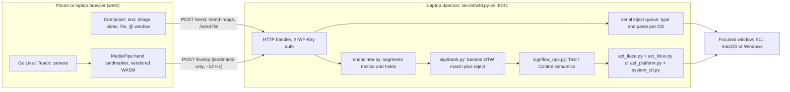

# AGENTS.md: working context for Sign-Flow (sign-wrap)

> Type and control your laptop without touching it.

This file is for a coding agent running on the founder's laptop (Linux, macOS or Windows). Use it to get the app running, fix small run errors, and help record the demo. Read it fully before you edit anything. Commands and paths below were last checked on 28 Oct 2026. Code is located by function or constant name, not line number, because line numbers drift: search for the name.

---

## 1. What the product is

Sign-Flow pairs a phone with a laptop (Linux X11, macOS or Windows) over the local network.

- **Composer:** on the phone you type text or attach an image, video or file. The daemon types or pastes it into the focused laptop window, or into a window you picked with `@`.
- **Go Live:** the phone (or laptop) camera tracks hand landmarks in the browser. The user teaches personal signs (3 takes each), and performing a sign either types its bound phrase (Text mode) or fires its bound laptop action (Control mode).
- **Privacy:** camera video never leaves the browser. Only 21-point hand landmarks per hand are sent to the laptop.
- **Daemon:** standard-library Python only, with no pip installs and no build step. On Linux it drives X11 through `xdotool`, `xclip`, `xprop` and `wmctrl` (**no ydotool or Wayland path**). On macOS and Windows it uses `server/act_platform.py`: osascript/System Events and `pbcopy` on macOS, PowerShell and user32 window messages on Windows.



Auth: the pairing key is stored in `~/.config/wf/key` (mode 600). The app sends it as the `X-WF-Key` header. The phone gets it from the QR link `?k=` or by entering the 8-character pair code, which `POST /pair` exchanges for the key.

---

## 2. Repository map (line anchors are from `main`)

| Path | What it does |
|---|---|
| `bin/wrap.js` | `npm link` target (`package.json` → `"bin": {"wrap": "bin/wrap.js"}`). Runs `bin/wrap` with bash on Linux and macOS, `server/wrap_cli.py` on Windows. `bin/wrap.cmd` and `bin/wrap.ps1` are shims for cmd.exe and PowerShell. |
| `server/wrap_cli.py` | The same CLI in stdlib Python (same subcommands, no curl). Used on Windows. |
| `scripts/linux.sh`, `macos.sh`, `windows.sh` | Per-OS setup: check tools, `npm install`, start. Any CLI subcommand passes through, e.g. `scripts/macos.sh status`. `windows.sh` runs in Git Bash. |
| `bin/wrap` | Bash CLI for Linux and macOS. `ROOT` is resolved with `readlink -f`, so the CLI always runs the copy it lives in. Subcommands: `start pair restart bridge stop status logs send install tunnel open doctor`. `bound_port()` reads the real port from the log. `pair_card()` prints the QR. `doctor` lists the dependencies. |
| `bin/wf` | Legacy alias. |
| `server/wfd.py` | The daemon. Config env vars are near the top (`MAX_BODY`, `BODY_CAPS`, `LIVE_*`). `list_windows()` (`wmctrl -lx`). `focus_window()`. Serial inject queue. `type_keystrokes`/`type_paste`. `send_text`. `send_image` (converts to PNG with `convert` on Linux, `sips` on macOS). `stream_upload` (writes to `~/wf-uploads`). `live_reset`. `route_gloss`. `_on_segment` (in Teach mode it stores an exemplar; when listening it matches). `live_kp`. `teach_begin`/`teach_end`. `bank_put`/`bank_delete`. Routes: `do_GET`, `do_POST`, `do_DELETE`. `serve()` tries the port, then the next 11 ports. |
| `server/endpointer.py` | Motion and hold segmenter. **Tunables are the `Endpointer.__init__` defaults**: `enter_v 1.5`, `exit_v 0.7`, `quiet_s 0.35`, `min_seg_s 0.20`, `max_seg_s 3.0`, `hold_s 0.45`, `hold_v 1.2`, `open_ratio 1.55`, `hold_end_s 0.5`, `min_hold_seg_s 0.6`. `PRESENCE_SCORE 0.25`. wfd builds it with the defaults, so edit the defaults here. |
| `server/signbank.py` | Personal sign bank. `RESAMPLE_N 32`, `MATCH_BAND 4`, `MIN_POINTS 8`, `MAX_EXEMPLARS 5`. `SignBank.__init__`: `reject_threshold 0.6`, `min_score 0.5`, `shape_dim_weight 0.1`, `still_frac 0.08`. `add_exemplar`, `match`, `save`/`load`. |
| `server/teach_train.py` | `verify()` re-matches each take against the others after Teach. It reports results only and never blocks a sign. |
| `server/signflow_ops.py` | Session and mode semantics (Text, Control, observe). |
| `server/act_iface.py` | Action contract, risk tiers and the focus guard (`verify_focus`, `run`). |
| `server/act_linux.py` | X11 provider (xdotool, wmctrl, xprop, xrandr). |
| `server/act_platform.py` | macOS and Windows provider (`CrossPlatformProvider`). wfd.py picks it when not on Linux. |
| `server/system_ctl.py` | Volume, media, screenshot, lock, wifi and bluetooth actions (pactl/amixer, playerctl, scrot/maim/gnome-screenshot, nmcli, rfkill, brightnessctl, loginctl). Each one is optional and shows only if its tool exists. |
| `server/macro.py` | Chained action steps (`kind: "macro"`). |
| `server/record_action.py` | Teach by demonstration (`xinput test-xi2`). |
| `server/packs.py` | Ready-made Teach packs: HELLO, NAMASTE (built in) and INTRO. `PACKS`. |
| `server/wfclip.py` | Holds a file on the clipboard for pasting (uses python3-xlib if present). |
| `server/qrcodegen.py`, `qrprint.py` | Vendored MIT QR generator and the terminal QR printer. |
| `web/index.html` | Single-page app shell, including the composer pill. The action button `#act` contains `#tray-live` (Go Live) and `#go` (send). |
| `web/js/app.js` | `App` core: API client `req()`, `upload()`, routes (`live teach signs laptop settings`), pairing `autoPair`/`pair`. `#tray-live` opens Live. |
| `web/js/compose.js` | Composer. `updateReady()` sets `.pill.ready`. `@` picker: `setTarget`, `openWinMenu` (calls `GET /windows`). `send()` routes to `/send-file` (video and other files), `/send-image` (images, resized by `squeeze`) or `/send` (text). The window id goes in the `X-WF-Window` header or `window` field. |
| `web/js/live.js` | Go Live. `KP_MS = 83` (about 12 Hz). Client palm-hold `HOLD = 420` ms. `boot()`. Laptop-camera fallback `useLaptop()`. Text \| Control `setMode()`: Text posts `observe` and adds each recognised word to the composer, Control posts `live` and fires actions. |
| `web/js/teach.js` | Teach wizard: one-tap action grid and name (`mountGrid`, quick.js) → record 3 takes → bind (pre-filled from the grid, or `@`) → done. `RESERVED` (PALM-OPEN, NAMASTE), `NEED = 3`, `onResp` (take counting), `buildBind`. |
| `web/js/quick.js` | The one-tap action tiles (`TILES`). A tile appears only if the laptop reports its tool. |
| `web/js/pose.js` | Loads the vendored landmarker and packs frames into 42 points. The score falls back to 1 when the landmarker gives no visibility. |
| `web/js/settings.js`, `laptop.js`, `drawer.js`, `library.js` | Settings (Vibrate on send), laptop pane, side drawer, sign library. |
| `web/sw.js` | Service worker. **`VERSION`** (`wf-shell-v37`). Bump it on every web change. |
| `web/css/compose.css` | Composer styles, including the `.act` black pill. |
| `web/vendor/mediapipe/` | Vendored MediaPipe Tasks Vision plus the model (Apache-2.0, see `NOTICE.md` and `MANIFEST`). Do not edit or remove it. |
| `cloud/contribute/` | Cloudflare Worker scaffold for opt-in landmark samples. **Not deployed, and no endpoint is configured** (`/status` → `contribute_url: ""`). Leave it alone for the demo. |
| `landing/` | Astro landing page (deployed separately). Not needed to run the app. |
| `server/tests/`, `tests/` | Python unit and contract tests, Node tests and browser harness pages. |
| `app/` | Optional Android shell (`wrap install` needs adb and the Android SDK). Not needed. |

---

## 3. Setup

Per OS, the one-step path is the matching script: `scripts/linux.sh`, `scripts/macos.sh`, or `scripts/windows.sh` (Git Bash). Each checks tools, runs `npm install` and starts the daemon; `setup` skips the start, `check` only checks.

- **macOS:** grant Accessibility to the terminal app (System Settings > Privacy & Security > Accessibility); Screen Recording only for the screenshot action. `doctor` checks python3, curl, osascript, pbcopy and sips.
- **Windows:** typing uses window messages; nothing beyond Node.js, Python 3 and the built-in PowerShell. Allow Python through the firewall on private networks.
- **Not yet verified end to end on macOS/Windows hardware:** volume, mute, brightness and lock (unit-tested with mocks only).

### Linux

**The session must be X11.** On the login screen pick "Ubuntu on Xorg" (or the equivalent). Check with `echo $XDG_SESSION_TYPE`, which must print `x11`.

```bash
# required (Debian/Ubuntu names)
sudo apt install -y python3 curl xdotool x11-utils xclip wmctrl imagemagick python3-xlib nodejs npm
# optional: adb (USB bridge), cloudflared (wrap tunnel), playerctl, pulseaudio-utils, scrot, libnotify-bin
git clone https://github.com/GC-WORK11/sign-wrap.git && cd sign-wrap
npm install          # no runtime deps; just sets up the package
npm link             # puts `wrap` on PATH (may need sudo, or use ./bin/wrap)
wrap doctor          # every required line must say [ok]
wrap start
```

`wrap doctor` does **not** check `wmctrl`. Without it, the `@` picker shows "No open windows". Install it.

| Command | Effect |
|---|---|
| `wrap start` | Starts `server/wfd.py` detached (`setsid`) and prints the LAN link, the QR and the pair code. If 8741 is busy, it uses the next free port (up to +11) and says so. |
| `wrap stop` | Kills the daemon (and the tunnel, if one is running). |
| `wrap restart` | Stop, then start. **The pair code changes on every start. The key does not.** |
| `wrap status` | Up or down, pid, RSS, LAN link, adb state, tunnel URL. |
| `wrap pair` | Shows the QR, link and code again. |
| `wrap logs` / `wrap logs -f` | Last 50 lines of the log, or follow it. |
| `wrap send "text"` | Types the text into the focused laptop window through `POST /send`. |
| `wrap bridge` | USB: `adb reverse tcp:8741`, so the phone can open `http://localhost:8741`. |
| `wrap tunnel` | cloudflared quick tunnel with an https URL and QR (see the caveat in §4). |
| `wrap doctor` | Dependency and session check. |

- **Port:** 8741 by default. Override with `WF_PORT=8800 wrap start`.
- **State dir:** `~/.config/wf/` holds `key` (pairing key), `signbank.json` (taught signs), `commands.tsv` (bindings) and `engine`.
- **Uploads:** files and videos go to `~/wf-uploads/`. Images go to `/tmp/wf-img-*.png`.
- **Logs and pid files live in the state dir:** `~/.config/wf/wfd.log`, `wfd.pid`, `tunnel.log` and `tunnel.pid` (set `WF_STATE_DIR` to move them). Older builds wrote `wfd.log` and `wfd.pid` into the repo folder; `wrap stop` still stops a daemon started that way. Never commit them.
- **Other env knobs (wfd.py):**
  - `WF_TEACH_TAKES` (3)
  - `WF_DUP_GAP_MS` (550)
  - `WF_PALM_SIGN` (PALM-OPEN)
  - `WF_NAMASTE_SIGN` (NAMASTE)
  - `WF_LIVE_MAX_FPS` (45)
  - `WF_MAX_UPLOAD` (1 GiB)
  - `WF_MAX_IMAGE` (64 MiB)
  - `WF_NO_LOG_TEXT=1` (keeps typed text out of the log)
  - `WF_TYPE_ALLOW` (window allowlist)

**Reset signs or state (back up first, never just delete):**

```bash
wrap stop
mv ~/.config/wf/signbank.json ~/.config/wf/signbank.json.bak   # all taught signs
mv ~/.config/wf/commands.tsv  ~/.config/wf/commands.tsv.bak    # all bindings
wrap start
# one sign only, while running:
curl -s -X DELETE -H "X-WF-Key: $(cat ~/.config/wf/key)" "http://localhost:8741/bank?gloss=V"
```

Do not touch `~/.config/wf/key` unless you want to re-pair every device.

---

## 4. Pairing, the camera, and caching

1. Run `wrap start`. Scan the QR with the phone (same Wi-Fi), or open `http://<laptop-ip>:8741/?k=...`. The key is then saved in the page's localStorage and removed from the URL.
2. You can also open `http://<laptop-ip>:8741/` and type the 8-character code shown by `wrap pair`.
3. If the link does not open, the firewall is the usual cause: `sudo ufw allow 8741/tcp`. `wrap start` prints this hint when the LAN URL is unreachable.

**The camera needs a secure context.** Browsers allow `getUserMedia` only on https or `localhost`, so a plain `http://<lan-ip>` page can send text and files but **cannot open the camera**. The options that work:

- **Laptop browser at `http://localhost:8741`.** This is the recommended way to record Teach and Go Live. On the phone, the Live card also offers the laptop camera button when the daemon reports one.
- **USB:** run `wrap bridge`, then open `http://localhost:8741` on the phone.
- **`wrap tunnel` (https through cloudflared):** fine for the composer. **It does not work for Go Live or Teach.** The daemon rejects every live and teach route that arrives through a proxy with `403 {"error":"local only"}` (`_proxied()` and `LIVE_POSTS` in wfd.py). That is intentional security behaviour, so don't remove it for the demo.
- `wrap tunnel` and `wrap bridge` use `$WF_PORT`/8741, not the fallback port. If `start` fell back to another port, run `WF_PORT=<that port> wrap tunnel`.

**Service-worker cache:** the shell is served stale-while-revalidate, so a phone can keep running old JS. After any change under `web/`:

1. Bump `VERSION` in `web/sw.js` (for example `wf-shell-v37` to `wf-shell-v38`).
2. `wrap restart`.
3. Hard-reload. On the laptop that's Ctrl+Shift+R. On the phone, close the tab and reopen it; if old code persists, clear the site data for the host.

An unbumped `VERSION` is the number-one reason a fix "doesn't show up".

---

## 5. Core flows and quick tests

Set up these variables first. Run the commands on the laptop with the daemon running.

```bash
K=$(cat ~/.config/wf/key); P=8741; H=(-H "X-WF-Key: $K")
curl -s localhost:$P/health                       # ok
curl -s "${H[@]}" localhost:$P/status | head -c 400   # engine, display x11, bank_size, live mode
```

| Flow | How it works | Quick test |
|---|---|---|
| **@ window picking** | Typing `@` in the composer opens `openWinMenu`, which calls `GET /windows` (`wmctrl -lx`, top-level windows with titles). Picking one shows a chip, and every send then carries the window id. The daemon calls `focus_window()` (`xdotool windowactivate --sync`, falling back to `wmctrl -i -a`) before it injects. | `curl -s "${H[@]}" localhost:$P/windows` |
| **Text** | `POST /send {text, mode:"type", window?}` → `xdotool type --clearmodifiers --delay 12`. `mode:"paste"` uses the clipboard plus Ctrl+V (Ctrl+Shift+V in terminals). An optional `expect` (wm class) returns 409 if the focus has moved. | `wrap send "hello"` or `curl -s "${H[@]}" -X POST localhost:$P/send -d '{"text":"hi","mode":"type"}'` |
| **Image** | `POST /send-image` with the raw bytes. The type is detected from the bytes, JPEG and WEBP are converted to PNG, the image goes on the clipboard via `wfclip.py`, and the daemon presses Ctrl+V. | `curl -s "${H[@]}" -H "Content-Type: image/png" --data-binary @web/icon-192.png localhost:$P/send-image` |
| **Video or file** | `POST /send-file` streams the upload to `~/wf-uploads/<ts>_<name>` (the name is sanitized), then pastes it as a file. Terminals get the path. | `curl -s "${H[@]}" -H "Content-Type: video/mp4" -H "X-File-Name: clip.mp4" --data-binary @clip.mp4 localhost:$P/send-file` |
| **Teach** | The UI asks for a name, then calls `POST /teach/begin {name}`. Camera frames stream to `/live/kp`. The endpointer closes a segment, and `_on_segment` stores it as an exemplar (`teach.got`). After 3 takes the UI calls `/teach/end`, which saves the bank and runs `teach_train.verify`. Then comes the one-tap bind grid. | `curl -s "${H[@]}" -X POST localhost:$P/teach/begin -d '{"name":"V"}'`, then `curl -s "${H[@]}" localhost:$P/bank` |
| **Go Live** | Hold an open palm for about 0.5 s. The client hold (`HOLD 420 ms`) and the endpointer mode event PALM-OPEN start listening. Each sign then becomes a segment, which is matched with DTW and accepted only if `dist <= 0.6`. Palms together (NAMASTE) pause listening. | Logs show `[wfd] mode -> ...` and match lines. `GET /live/state` shows `listening`, `last_match` and `feed`. |
| **Text \| Control** | A toggle in Live. Text posts `/live/mode {"mode":"observe"}`: recognised words are added to the composer and you tap send. Control posts `{"mode":"live"}`: the sign's bound action runs. The API also accepts `text` and `control`. | `curl -s "${H[@]}" -X POST localhost:$P/live/mode -d '{"mode":"control"}'` |
| **Quick actions** | The tiles in `quick.js` post `POST /act/run {action:{kind:"builtin",tool:"key.press",args:{keys:"alt+Tab"}}}`. Tier-2 actions (such as Close window) wait for `/act/confirm`. The catalog is at `GET /act`. | `curl -s "${H[@]}" -X POST localhost:$P/act/run -d '{"action":{"kind":"builtin","tool":"key.press","type":"key_press","args":{"keys":"ctrl+l"}}}'` |
| **Packs** | `GET /packs`, then `POST /packs/install {id:"hello"}`. HELLO and INTRO still need takes; NAMASTE is built in. | `curl -s "${H[@]}" localhost:$P/packs` |

**Teach rules for a good take:**

- Hold each sign still for about **1 s**, then drop your hand out of frame or pause.
- Use **3 takes**.
- Put the camera on a stand in good light, with your hands and chest in frame.
- **Never teach an open palm.** It is the Live start gesture, and `PALM-OPEN` and `NAMASTE` are reserved (400 from `/teach/begin`).
- Teach visually distinct shapes: **V**, **fist**, **index point** and **thumbs-up**. Don't teach V and L together.

---

## 6. Known issues and troubleshooting

| Symptom | Cause | Fix / file |
|---|---|---|
| Teach shows 0/3 takes and "too short or had no hands" | The hand never moves (an open palm held still is read as the PALM-OPEN mode event, not a sign), or the take is under about 0.67 s (`MIN_POINTS 8` at 12 Hz), or no hand was detected | Bring the hand in, hold the shape 1 s, then drop it. Don't use an open palm. In the log, check for segment lines. If needed, lower `min_hold_seg_s` or `hold_end_s` in the `Endpointer.__init__` defaults. |
| No hands detected at all (Live idle, 0 exemplars) | Landmark score of 0 | Already fixed: `pose.js` falls back to score 1. If you see 0 again, check that `PRESENCE_SCORE` (endpointer) and `min_score` (signbank) are not above the scores pose.js sends. |
| V matched as L or C, or WIGGLE matched as POINT | The shape channel is a per-segment median (`shape_dim_weight 0.1`) and the trajectory is only the hand centroid, so finger motion is averaged away | Teach distinct shapes only (V, fist, point, thumbs-up). Optionally raise `shape_dim_weight` in `signbank.py` a little and re-run `test_signbank`. |
| Fast signs are cut, or two signs merge into one | Endpointer thresholds | The `Endpointer.__init__` defaults in `endpointer.py`. `max_seg_s` (3.0) force-closes long segments. `hold_end_s` (0.5) closes a segment on a held shape. `exit_v`/`quiet_s` set the quiet end. Sign slowly with a 1 s hold. |
| An old sign wins over a new one | Old exemplars in `~/.config/wf/signbank.json` (up to 5 per sign) | `DELETE /bank?gloss=NAME`, or back up and move `signbank.json` aside (§3), then re-teach. |
| Go Live never starts listening | The open palm isn't recognised (openness under `open_ratio 1.55`, or the hand moves more than `hold_v 1.2`) | Spread your fingers, hold still for 0.5 s, keep the palm facing the camera. Tune the `Endpointer.__init__` defaults in `endpointer.py`. |
| "That window is closed. Pick another." after a send | The picked window was closed or reopened, so its id is gone. The daemon answers `409 window gone` and types nothing; the phone clears the `@` chip | Tap `@` and pick the window again. See `focus_window` and `WINDOW_GONE` in wfd.py. |
| "No open windows" in the `@` list | `wmctrl` is missing, or the WM has no EWMH support | `sudo apt install wmctrl`. Check with `wmctrl -lx`. |
| Multiple spaces collapse with `wrap send` | `text="$*"` joins arguments with single spaces | Quote the text: `wrap send "a  b"`. The composer path keeps spacing exactly. |
| Characters dropped or wrong in some apps | xdotool typing plus the keyboard layout | Use paste mode (`{"mode":"paste"}`), or check the layout with `setxkbmap -query`. |
| `adb: command not found` / `adb: no device` in `wrap status` | adb is optional | Harmless. Ignore it. |
| A fix doesn't appear after an edit | The CLI runs another checkout: `ROOT` comes from `readlink -f` of the linked binary | `readlink -f "$(which wrap)"`. Re-run `npm link` in the right folder, or use `./bin/wrap`. |
| `port 8741 busy — using :8742` | An old daemon or another app holds the port | `wrap stop`. Then `ss -ltnp \| grep 874` and kill the stale `wfd.py`. Or set `WF_PORT`. |
| `daemon failed — see ~/.config/wf/wfd.log (wrap logs)` | Python error, or all 12 ports busy | Run `wrap logs`, or start it in the foreground: `python3 server/wfd.py`. |
| Nothing is typed. Doctor says `wayland` | xdotool can't inject on Wayland | Log out and choose the Xorg session. There is no ydotool fallback. |
| The camera won't open on the phone | Plain http LAN page (no secure context) | Use the laptop browser at localhost, or `wrap bridge` (§4). |
| Live or Teach returns `403 local only` | The request came through `wrap tunnel` | Expected. Use localhost or USB for the camera. |
| `403 unpaired` | Missing or stale key in the browser | Re-scan the QR from `wrap pair`, or enter the code. |
| Composer button is pink, has no arrow, or looks wrong | A CSS rule lost in a merge, or an old cached shell | `web/css/compose.css`: `.act` must use `background: var(--ink)` with a white glyph and **no** `.pill.ready .act` pink rule. Bump `sw.js` `VERSION` and hard-reload. |
| An image pastes as a path or nothing | `convert` (imagemagick) or `python3-xlib` is missing | Install both. `wrap doctor` flags them. |
| An upload fails with 413 or 507 | Size cap, or low disk space | `WF_MAX_UPLOAD` / `WF_MAX_IMAGE`. Free some disk space (64 MB headroom is kept). |

**What a healthy log looks like (`wrap logs`):**

```
[wfd] listening on http://0.0.0.0:8741 (key: ~/.config/wf/key)
[wfd] pair code: XXXXXXXX (valid until stop)
[wfd] type: 'hello world'
[wfd] image: 7210B image/png into 'gedit'
[wfd] file: 20000B 1793107206_clip.mp4 -> ~/wf-uploads/... into 'code'
[wfd] mode -> text
```

Errors start with `[wfd] <area>: <exception>` (for example `inject:`, `windows:`, `match:`, `add_exemplar:`).

---

## 7. Rules for any change

- **Look:**
  - Light theme with an off-white page and near-black ink (`--ink #0a0a0a`, `web/css/app.css`).
  - The **composer and its send/Go Live button are dark black in every state**: a white waveform when empty (Go Live) and a white arrow when there is something to send.
  - Pink (`--accent`) is **only** for the lotus logo and small accents. Never use it for the composer, the send button or large surfaces.
- **No taglines, helper text or explanatory paragraphs** in the UI. Labels are one or two words.
- **Teach** is a one-tap action grid: tap an action (the name fills in), 3 takes, done. Don't add forms or steps.
- **No branding as a specific national sign language,** and no names of research datasets anywhere, in code, comments, UI or docs. Signs are personal and taught by the user.
- **Never commit:**
  - video, or images of people or hands;
  - `.env` files, keys or credentials, or the `~/.config/wf/key` contents;
  - model weights other than the vendored MediaPipe model;
  - recorded landmark dumps;
  - `wfd.log`, `wfd.pid` or `tunnel.log`.
- **License:**
  - The project is MIT.
  - Keep `web/vendor/mediapipe/NOTICE.md` and `MANIFEST` (Apache-2.0) and the header in `server/qrcodegen.py` (MIT).
  - Add no GPL or non-commercial code.
- **Git:**
  - Normal commits only. No force pushes and no history rewrites.
  - Keep the daemon standard-library only. Don't add pip dependencies.
- **Security behaviour stays:** key auth, rejecting proxied requests on the live routes, the focus guard, tier-2 confirmations, and `/pair-info` answering on localhost only.
- After any web edit, bump `web/sw.js` `VERSION`.

---

## 8. Demo recording script (about 2 minutes)

**Pre-flight (10 minutes before):**

1. X11 session confirmed. `wrap doctor` is all `[ok]`.
2. `git pull`, then `wrap restart`, then a hard-reload of `http://localhost:8741` in the laptop browser. The phone is re-paired from the `wrap pair` QR.
3. Open the demo targets: a text editor (gedit or VS Code) and a chat or doc page in the browser. Close anything private, turn notifications off (Do Not Disturb), and hide the terminal showing the key and QR from the recording.
4. Back up and reset old signs (§3). Teach **V** and **fist** (and **point** if there's time), 3 takes each, held 1 s, in the same light and camera position you'll record in. Bind V to typing "Hello" (Text) and fist to an action such as Switch app (Control).
5. Rehearse Go Live once: palm, then V, then check "Hello" appears. If a sign misfires, re-teach it. Don't tune thresholds right before recording.
6. Camera on a stand, light in front of you, hands and chest in frame. Screen recorder at 1080p. Phone screen mirrored or filmed.

**Shot list:**

| Time | Shot | Action |
|---|---|---|
| 0:00-0:10 | Laptop, the title on screen | "Type and control your laptop without touching it." Run `wrap start`, and the QR appears. |
| 0:10-0:25 | Phone | Scan the QR. The composer opens paired. |
| 0:25-0:45 | Phone and laptop split | Type `@`, pick the editor window, type a line, tap the black send button. The text lands in the editor. |
| 0:45-1:05 | Phone and laptop | Attach a photo, then send it into the doc or chat. Attach a short video (not of a person), then send it. |
| 1:05-1:15 | Phone | Tap one quick action tile (Switch app or Volume) and show it happen on the laptop. |
| 1:15-1:35 | Laptop camera (localhost) | Teach a new sign: tap an action in the grid, 3 takes held 1 s, Finish. |
| 1:35-1:55 | Laptop camera | Go Live: show an open palm to start listening. Text mode: V types "Hello". Switch to Control: fist switches the app. Palms together to stop. |
| 1:55-2:00 | Landing page and repo | End card: landing URL and `github.com/GC-WORK11/sign-wrap`. |

If a sign fails on camera, cut and retake that shot. Don't narrate failures and don't fake recognition.

---

## 9. Tests

```bash
cd server && python3 -m unittest discover -s tests      # 333 tests, about 15 s; expect "OK" with 3 to 6 skips depending on the session and 1 expected failure
cd .. && node --test tests/contribute.test.mjs tests/kp-pack.test.mjs   # 10 pass
# single module:
cd server && python3 -m unittest tests.test_endpointer -v
```

- The tests need no X display or camera; X11 calls are stubbed.
- `tests/selftest.html`, `tests/probe.html` and `tests/run-teach-ui.sh` are browser harnesses that run against a running daemon (or `tests/stub_wfd.py`).
- Run the Python suite after any change to `server/`, and re-check `/health`, `wrap send` and one image send by hand.

**Isolated smoke run (doesn't touch your real signs):**

```bash
T=$(mktemp -d); export WF_PORT=8811
HOME=$T ./bin/wrap start && HOME=$T ./bin/wrap send "smoke"; HOME=$T ./bin/wrap stop; unset WF_PORT
```
