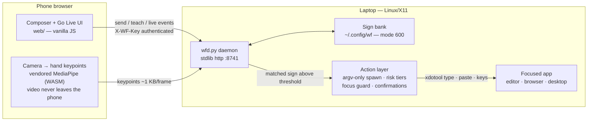
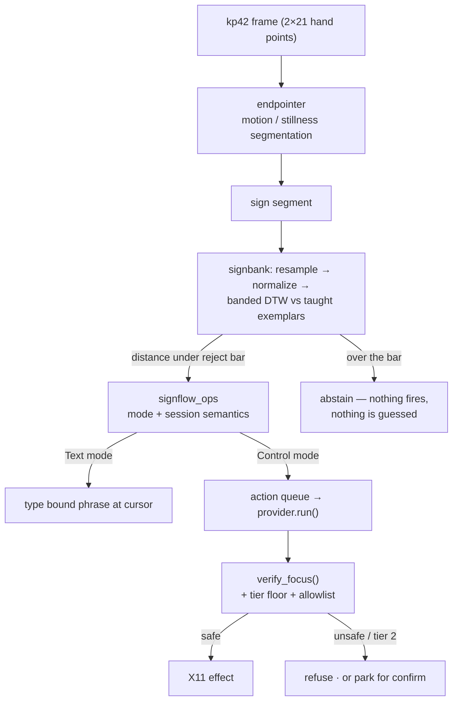
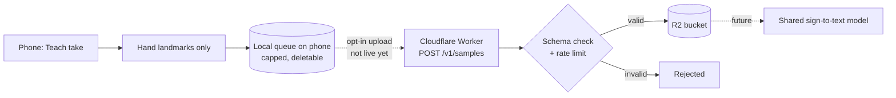

# Sign-Flow

Type and control your laptop without touching it.

Live site: https://sign-flow-eight.vercel.app

Sign-Flow pairs your phone with your Linux laptop over your own network. Type or attach files on the phone and they land in the focused laptop window. Teach the phone camera a few signs of your own, and performing a sign types a phrase or runs a laptop action.

- The phone composer sends text, images, videos and files; they are typed or pasted into the focused window.
- Go Live turns the phone camera into a personal sign controller. Teach a sign in three takes, bind it to a phrase or an action, and perform it to fire the binding.
- Camera video never leaves the phone. Hand tracking runs in the browser and only hand landmark points are sent to the laptop.

The daemon is standard-library Python with no dependencies and no build step.

## Quick start

Requires Linux with an X11 session on the laptop, Python 3, Node.js (for `npm link`), and any modern browser on the phone.

```bash
git clone https://github.com/GC-WORK11/sign-wrap.git
cd sign-wrap
npm install
npm link
wrap start
```

`wrap start` runs the daemon in the background (it keeps running after the terminal closes) and prints a local network link, a QR code and a pairing code. Scan the QR code with the phone, or open the link in any phone browser, and the composer is ready. If the default port is taken, the next free port is used and printed.

**Camera and secure context.** Phone browsers only allow the camera on a secure page. Plain `http://<lan-ip>` links work for sending text and files, but not for Go Live. For the camera, use the laptop browser at `http://localhost:<port>`, connect the phone over USB with `wrap bridge` (then open `http://localhost:8741` on the phone), or run `wrap tunnel` for an https link (requires `cloudflared`).

```bash
wrap status   # daemon state, pid, memory, link
wrap logs     # daemon log
wrap doctor   # checks the tools the daemon uses
wrap stop     # shut down
```

## Features

| Feature | How it works |
|---|---|
| Composer send | Text, image, video, file from the phone; typed at the cursor or pasted into the focused app |
| Go Live — Text | A performed sign types its bound phrase (e.g. "Hello") at the cursor |
| Go Live — Control | The same sign fires its bound laptop action — open an app, press keys, switch windows |
| Teach | Record 3 takes of your own sign; held-out verification confirms it before the sign goes live |
| Prefilled packs | One-tap ready signs: Hello, Namaste (listening pause), Introduce yourself |
| Laptop actions | `@` picker: apps, windows, workspaces, media, volume, screenshots, clipboard, chained steps — shown only while a laptop is connected |
| Focus guard | Type/key actions verify the focused window at fire time and refuse anything unsafe; an optional allowlist (`WF_TYPE_ALLOW`) pins them to designated windows |
| Confirm tiers | Destructive actions (e.g. close window) park for an explicit confirmation before running |

## Architecture



## Data flow



## Teach, perform, act

```mermaid
sequenceDiagram
    participant U as user
    participant P as phone browser
    participant D as daemon
    participant X as laptop / X11
    U->>P: Teach → name + bind action → perform ×3
    P->>D: POST /teach/begin, /teach/take
    D->>D: exemplars → bank; held-out take verifies
    D-->>P: state: ready
    U->>P: perform the sign (Go Live)
    P->>D: POST /live/kp (keypoints only)
    D->>D: endpointer → DTW match
    alt Text mode
        D->>X: type the bound phrase at the cursor
    else Control mode
        D->>X: focus check → run the bound action
    end
    D-->>P: match + action result on the live feed
```

## Tests

```bash
cd server && python3 -m unittest discover -s tests
node --test tests/contribute.test.mjs tests/kp-pack.test.mjs
```

## Limitations

See [`LIMITATIONS.md`](LIMITATIONS.md). In short:

- Signs are personal and taught by each user. Sign-Flow is not a fixed sign-language recognizer.
- Laptop actions need X11. Wayland is detected and reported.
- Go Live needs a secure context on the phone (see Quick start).
- Typing and key actions check the focused window first and refuse when it cannot be verified.

## Repository map

```
bin/wrap               CLI: start, stop, status, logs, pair, bridge, tunnel, doctor
server/wfd.py          daemon: http, pairing, send, teach, live, actions
server/signbank.py     taught-sign bank: normalize, banded DTW, open-set reject
server/endpointer.py   motion segmentation
server/signflow_ops.py session and mode semantics
server/act_iface.py    action contract, risk tiers, focus guard
server/act_linux.py    X11 provider (xdotool, wmctrl, xprop)
server/system_ctl.py   system actions (media, volume, workspaces)
server/packs.py        ready-made Teach packs
server/qrcodegen.py    vendored QR generator
server/tests/          unit and contract tests
web/                   phone app: composer, Go Live, Teach, settings
web/vendor/mediapipe/  vendored MediaPipe hand landmarker (no CDN)
app/                   optional Android shell for the web app
cloud/contribute/      Cloudflare Worker for opt-in training samples (not deployed)
landing/               landing page source (Astro)
tests/                 browser and Node tests
tools/fetch-vendor.sh  re-fetch and verify the vendored MediaPipe files
```

## Licenses

All components are commercial-compatible:

| Component | License | File |
|---|---|---|
| Sign-Flow (this repo) | MIT | `LICENSE` |
| QR Code generator (vendored `server/qrcodegen.py`) | MIT — © Project Nayuki | header of the file |
| MediaPipe Tasks Vision + hand-landmarker model (vendored `web/vendor/mediapipe/`) | Apache-2.0 — © Google | `web/vendor/mediapipe/NOTICE.md` + `MANIFEST` |

`cloud/contribute/` uses only dev tooling (TypeScript Apache-2.0, Wrangler MIT OR Apache-2.0, workers-types MIT OR Apache-2.0); nothing from it ships in the app.

No GPL/AGPL, non-commercial, or research-only licensed code ships in this tree.

## Roadmap

Today every sign is personal: it is taught on your phone and matched on your laptop. The next step is a shared sign-to-text model that works before you teach anything.

That model will be trained only on samples people choose to share. Sharing is an opt-in setting, **Share training samples (beta)**, off by default. When it is on, each Teach take is kept on the phone as hand landmarks only. Upload is not live in this release. See [`PRIVACY.md`](PRIVACY.md) for exactly what is and is not collected.



| Stage | State |
|---|---|
| Opt-in setting and local landmark queue | shipped, off by default |
| Intake Worker (`cloud/contribute/`) | written and tested, not deployed |
| Upload from the app | off: no endpoint is configured |
| Shared model | planned |

## Security

See [`SECURITY.md`](SECURITY.md) for the threat model and how to report a vulnerability. Privacy details are in [`PRIVACY.md`](PRIVACY.md).
