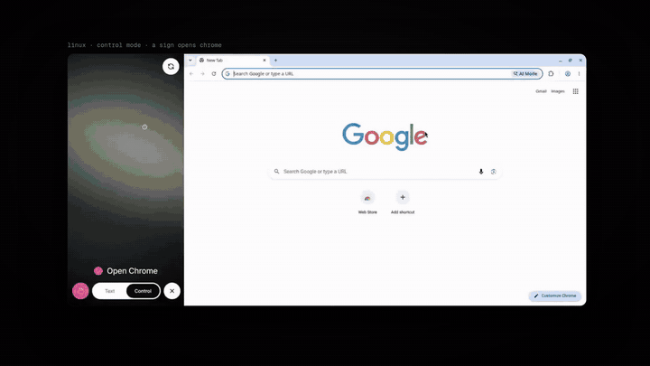
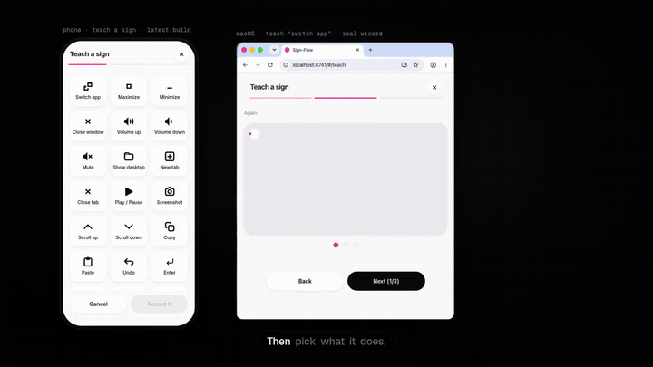
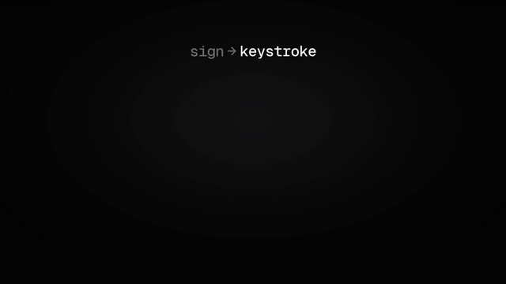
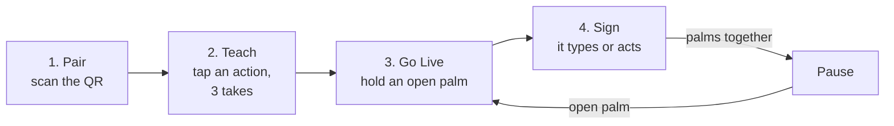
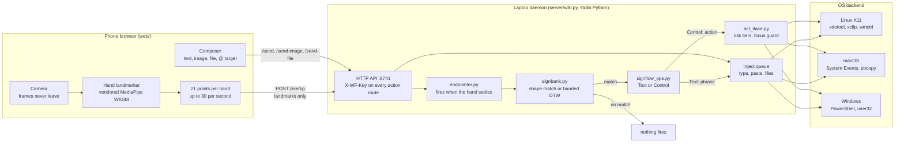
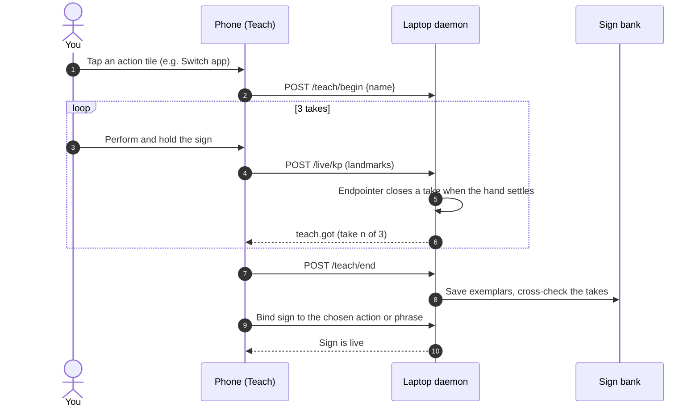
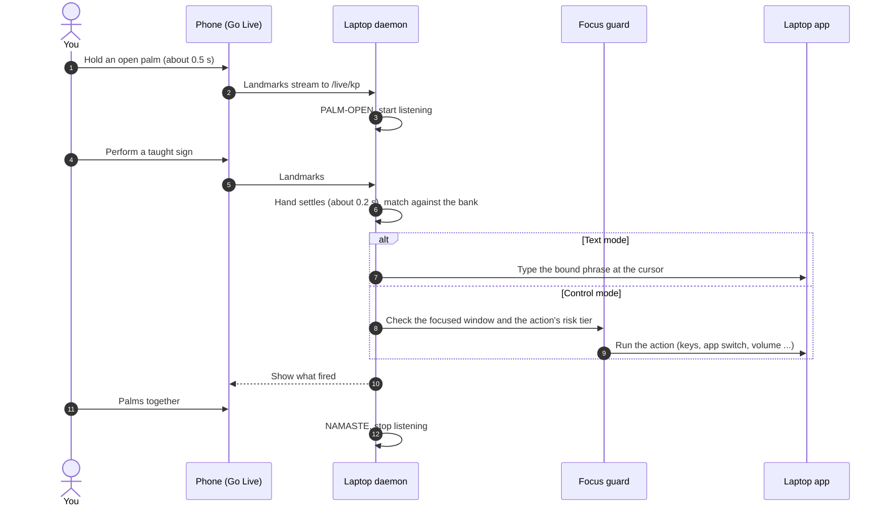
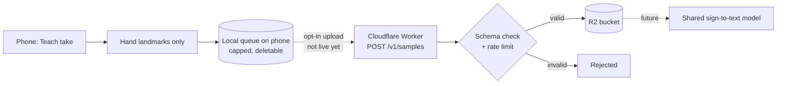

<div align="center">

# Sign-Flow

**Type and control your laptop without touching it.**

Teach your phone camera a few hand signs of your own. Perform one, and your laptop types a phrase or runs an action.

[Live site](https://sign-flow-eight.vercel.app) · [Quick start](#quick-start) · [How to use](#how-to-use) · [How it works](#how-it-works) · [Wispr Wrap](#the-voice-half-wispr-wrap)




<sub>A taught sign switches apps, another opens Terminal (macOS, recorded hand landmarks replayed through real recognition and real keys).</sub>

</div>

---

## What it is

Sign-Flow turns the phone you already own into a hand-sign controller for your laptop.

- **Your signs, your actions.** There is no fixed vocabulary. You teach a sign in three takes and bind it to a phrase or a laptop action with one tap.
- **Two ways to fire.** *Text* mode types the bound phrase at the cursor. *Control* mode runs the bound action: switch apps, open a terminal, scroll, change volume, take a screenshot.
- **Video stays on the phone.** Hand tracking runs in the phone browser. Only 21 landmark points per hand go to the laptop, over your own network.
- **Nothing to install on the phone.** It is a web page served by the laptop. Scan a QR code and you are paired.
- **Small laptop side.** The daemon is standard-library Python: no pip installs, no build step, no cloud account.

It also works as a plain phone-to-laptop composer: type, paste images or send files from the phone and they land in the laptop window you pick.

<table>
<tr>
<td width="50%"></td>
<td width="50%"></td>
</tr>
<tr>
<td><sub><b>Teach.</b> Tap what the sign should do, perform it three times, it is live.</sub></td>
<td><sub><b>Fast and private.</b> About 0.1 s from a finished sign to the first key; only hand points leave the phone.</sub></td>
</tr>
</table>

## Quick start

You need **Python 3.7+** and **Node.js with npm** on the laptop, and a modern browser on the phone. Each setup script checks its tools, runs `npm install` and starts the daemon. Pass `check` to only check, or `setup` to install without starting.

<details open>
<summary><b>Linux</b> (X11 session)</summary>

Log in to an X11 session (for example "Ubuntu on Xorg"); `echo $XDG_SESSION_TYPE` should print `x11`.

```bash
sudo apt install -y nodejs npm python3 curl xdotool x11-utils xclip wmctrl imagemagick python3-xlib
git clone https://github.com/GC-WORK11/sign-wrap.git
cd sign-wrap
scripts/linux.sh
```

The script prints the matching `dnf` and `pacman` lines if a tool is missing.
</details>

<details>
<summary><b>macOS</b></summary>

```bash
brew install node python
git clone https://github.com/GC-WORK11/sign-wrap.git
cd sign-wrap
scripts/macos.sh
```

The first time, macOS asks to let your terminal control the computer. Allow it under System Settings > Privacy & Security > Accessibility, then run `scripts/macos.sh` again.
</details>

<details>
<summary><b>Windows</b></summary>

Install [Git for Windows](https://git-scm.com/download/win) (includes Git Bash), [Node.js LTS](https://nodejs.org) and [Python 3](https://www.python.org) with "Add python.exe to PATH" ticked. In **Git Bash**:

```bash
git clone https://github.com/GC-WORK11/sign-wrap.git
cd sign-wrap
scripts/windows.sh
```

From cmd.exe or PowerShell: `npm install`, then `bin\wrap.cmd start`. Allow Python through Windows Defender Firewall on private networks.
</details>

When it starts you get a **QR code**, a **LAN link** and an **8-character pair code**. If port 8741 is busy, the next free port is used and printed. Check it is up:

```bash
scripts/linux.sh status        # or macos.sh / windows.sh
curl -s -o /dev/null -w '%{http_code}\n' http://localhost:8741/   # 200
```

## How to use



1. **Pair.** Scan the QR printed by `start` with your phone camera. The web app opens already paired; the key is kept in the browser and removed from the address bar. No QR? Open `http://<laptop-ip>:8741/` and type the pair code.
2. **Open the camera securely.** Phone browsers only allow the camera on `https` or `localhost`. For Teach and Go Live, either connect the phone over USB and run `wrap bridge` (then open `http://localhost:8741` on the phone), or use the laptop browser at `http://localhost:8741` with the laptop webcam. The composer works over plain LAN.
3. **Teach a sign.** Open Teach and tap what it should do in the **one-tap action grid**: Switch app, Maximize, Show desktop, New tab, Volume, Play / Pause, Screenshot, Scroll, Copy, Paste, Undo, Enter, open an app, or a phrase to type. Tiles appear only for tools your laptop has. Perform the sign **three times**, holding the shape for about a second each time, then finish. The takes are checked against each other and the sign is live straight away.
4. **Go Live.** Tap the live button and **hold an open palm** for about half a second to start listening. Perform a taught sign: in **Text** mode its phrase is typed at the cursor; in **Control** mode its action runs. **Palms together** pauses listening.
5. **Composer.** Type in the box and send: text lands at the laptop cursor. Type `@` to pick a target window first. Images are pasted as pictures; videos and files are saved to `~/wf-uploads/` and pasted as files.

**Signs that work best** differ in which fingers are straight: **V**, **fist**, **index point**, **three fingers**. The open palm and palms-together are reserved for start and pause. Avoid teaching point and L, or fist and thumbs-up, together: the thumb is not part of the shape.

## How it works



Hand landmarks are found in the phone browser. Segmenting and matching happen in the daemon on the laptop, so your taught signs (`~/.config/wf/signbank.json`) never leave your machine.

### Teach



### Go Live



### Measured

End-to-end runs on a CPU-only Linux test machine: Chrome's fake camera plays recorded hand clips through the app's own hand model, and keys go into real X11 windows.

| Check | Result |
|---|---|
| Palm, then V, typed "hello" into an xterm | 9/9 and 7/7, 0 misfires |
| Finished sign on screen to first key | median 107 ms (9 tries), 189 ms (7 tries, fresh clone) |
| Held point, fist and V on real phone-camera clips (taught on one recording, tested on another) | 14/14 and 11/11, 0 wrong; open palm 6/6 |
| Test suites | Python unittest OK, Node 68/68 pass |

On a laptop with a GPU the hand model runs faster than on this test machine; detection is capped at 30 frames a second by design.

## Privacy

- Camera video and photos of your hands are processed in the phone browser and never sent anywhere.
- Only hand landmark coordinates travel, from the phone to your own laptop, on your network.
- Taught signs, bindings and logs stay in `~/.config/wf/` on the laptop.
- No analytics, no account, no cloud calls. The opt-in sample sharing described in the [roadmap](#roadmap) is not in this release, and no endpoint is configured.
- Every action route needs the pairing key (`~/.config/wf/key`, mode 600). Live and Teach are refused through a public tunnel on purpose.

Details: [`PRIVACY.md`](PRIVACY.md) and [`SECURITY.md`](SECURITY.md).

## The voice half: Wispr Wrap

Sign-Flow is the hands half of one idea: **talk when you can, sign when you can't.**

[**Wispr Wrap**](https://github.com/GC-WORK11/wispr-wrap) is the voice half. There is no Wispr Flow app for Linux, so Wispr Wrap makes your phone the mic: dictate with Wispr Flow on the phone, and the text types itself at your laptop cursor. Sign-Flow grew out of it and uses the same phone-to-laptop composer, so anything you dictate into the Sign-Flow composer with Wispr Flow lands on the laptop the same way.

> Unofficial. Sign-Flow and Wispr Wrap are independent projects and are not affiliated with or endorsed by Wispr.

## Troubleshooting

| Symptom | Fix |
|---|---|
| Phone cannot open the link | Same Wi-Fi on both? Allow the port: `sudo ufw allow 8741/tcp` (Linux), allow Python in the macOS or Windows firewall prompt. |
| Camera does not start on the phone | The page is plain `http` on a LAN IP. Use USB with `wrap bridge` and open `http://localhost:8741`, or use the laptop browser at `localhost`. |
| Teach stays at 0/3 takes | Don't teach an open palm (it starts listening). Bring the hand in, hold the shape about a second, then drop it. Keep the same shape for all three takes. |
| Go Live never starts listening | Spread all fingers, palm to the camera, hold still for half a second. If the hand was already open in view, close it and open it again. |
| A sign fires late or not at all | Hold the shape still for a moment. Re-teach signs taught on an older build. `wrap logs` prints one line per accepted sign. |
| Two signs get confused | Teach shapes that differ in straight fingers (V, fist, point, three fingers). |
| Nothing is typed on Linux | You are on Wayland. Pick an Xorg session at login; `scripts/linux.sh doctor` reports it. |
| "That window is closed. Pick another." | The `@` target closed. Tap `@` and pick it again. |
| macOS types nothing | Grant Accessibility to your terminal app, then `scripts/macos.sh restart`. |
| Port 8741 is busy | The next free port is used and printed, or set `WF_PORT=8800`. |

More in [`LIMITATIONS.md`](LIMITATIONS.md).

## Notes per OS

### Linux

- Typing uses `xdotool`; paste and images go through `xclip`; the `@` picker lists windows with `wmctrl`.
- Wayland is detected and reported by `doctor`. Typing and window control need X11.
- If the phone cannot open the link, allow the port: `sudo ufw allow 8741/tcp`.

### macOS

- **Accessibility.** Typing, key presses and app focus go through System Events. Grant Accessibility to the terminal app that runs `start` (Terminal, iTerm, etc.): System Settings > Privacy & Security > Accessibility. `scripts/macos.sh check` tells you whether it is granted. Restart the daemon after granting it.
- **Screen Recording.** Only the screenshot action needs it. Grant it to the same terminal app under System Settings > Privacy & Security > Screen Recording.
- Text goes on the clipboard with `pbcopy`. Images and files go on the pasteboard through `osascript` (NSPasteboard), and images are converted with `sips`. All three are built in. `blueutil` (Homebrew) is optional, for the Bluetooth action.
- If macOS asks whether Python may accept incoming connections, allow it, or the phone cannot reach the daemon.

### Windows

- Typing works by posting window messages to the focused window, so it needs no extra tools, drivers or admin rights. Clipboard, images and the window list use the built-in PowerShell.
- On first start, Windows Defender Firewall may ask about Python. Allow it on private networks so the phone can connect.
- The daemon keeps running after Git Bash closes. Stop it with `scripts/windows.sh stop`.

### Not yet verified on real hardware

Volume, mute, brightness and lock are implemented for macOS and Windows and pass the unit tests, but have not been checked end to end on a physical Mac or Windows PC. On Linux they are optional and appear only when their tool is installed.

## CLI reference

The same commands exist on every OS (`bin/wrap` on Linux and macOS, `server/wrap_cli.py` on Windows, both behind `wrap` after `npm link`).

| Command | Effect |
|---|---|
| `wrap start` | Start the daemon and print the LAN link, QR and pair code |
| `wrap pair` | Show the QR, link and code again |
| `wrap restart` | Stop, then start (new pair code, same key) |
| `wrap status` | Up or down, pid, memory, LAN link, USB and tunnel state |
| `wrap logs` / `wrap logs -f` | Last lines of the daemon log, or follow it |
| `wrap send "text"` | Type text into the focused laptop window |
| `wrap doctor` | Check required and optional tools and the session |
| `wrap bridge` | USB: `adb reverse` so the phone can use `localhost:8741` |
| `wrap tunnel` | https link through `cloudflared` |
| `wrap install` / `wrap open` | Build and install, or launch, the optional Android app |
| `wrap stop` | Stop the daemon and any tunnel |

Set `WF_PORT` to use another port, for example `WF_PORT=8800 wrap start`. Taught signs, bindings, the log and the pid file live in `~/.config/wf/` (`wfd.log`, `wfd.pid`; set `WF_STATE_DIR` to move them). `wrap logs` shows the log.

## Project structure

```
sign-wrap/
├── bin/                 wrap CLI (bash for Linux and macOS, .cmd/.ps1 shims and Node entry)
├── scripts/             linux.sh, macos.sh, windows.sh: check, install, start
├── server/              laptop daemon, stdlib Python
│   ├── wfd.py           HTTP API, pairing, send, Teach, Go Live, actions
│   ├── endpointer.py    decides when a sign happened (settle, hold, palm, namaste)
│   ├── handshape.py     finger layout and extension helpers
│   ├── signbank.py      your taught signs: shape match and banded DTW
│   ├── signflow_ops.py  Text and Control modes
│   ├── act_iface.py     action contract, risk tiers, focus guard
│   ├── act_linux.py     Linux X11 backend
│   ├── act_platform.py  macOS and Windows backends
│   ├── system_ctl.py    volume, media, screenshot, lock, brightness
│   ├── wrap_cli.py      the CLI in Python (Windows)
│   └── tests/           unit and contract tests
├── web/                 phone web app: composer, Teach, Go Live, settings
│   └── vendor/mediapipe/  vendored hand landmarker (no CDN)
├── tests/               Node tests and headless browser checks
├── landing/             landing page source (Astro)
├── app/                 optional Android shell for the web app
├── cloud/contribute/    opt-in sample intake Worker (not deployed)
└── docs/                brand assets and README media
```

## Tests

```bash
cd server && python3 -m unittest discover -s tests   # expect OK (a few skips without an X display)
cd .. && node --test tests/*.test.mjs                # 68 pass
tests/run-golive-ui.sh && tests/run-reopen-ui.sh     # headless Chrome with a fake camera
```

The Python suite covers the macOS and Windows backends with mocked system calls, so it runs on any OS.

## Licenses

All components are commercial-compatible:

| Component | License | File |
|---|---|---|
| Sign-Flow (this repo) | MIT | `LICENSE` |
| QR Code generator (vendored `server/qrcodegen.py`) | MIT — © Project Nayuki | header of the file |
| MediaPipe Tasks Vision + hand-landmarker model (vendored `web/vendor/mediapipe/`) | Apache-2.0 — © Google | `web/vendor/mediapipe/NOTICE.md` + `MANIFEST` |

`cloud/contribute/` uses only dev tooling (TypeScript Apache-2.0, Wrangler MIT OR Apache-2.0, workers-types MIT OR Apache-2.0); nothing from it ships in the app.

No GPL/AGPL, non-commercial, or research-only licensed code ships in this tree.

## Roadmap

Today every sign is personal: it is taught on your phone and matched on your laptop. The next step is a shared sign-to-text model that works before you teach anything.

That model will be trained only on samples people choose to share. Sharing will be an opt-in setting, **Share training samples (beta)**, off by default. The setting is not in the app in this release, so nothing is collected. When it ships and is on, each Teach take will be kept on the phone as hand landmarks only. See [`PRIVACY.md`](PRIVACY.md) for exactly what is and is not collected.



| Stage | State |
|---|---|
| Local landmark queue (`web/js/contribute.js`) | written and tested, no setting in the app yet |
| Intake Worker (`cloud/contribute/`) | written and tested, not deployed |
| Upload from the app | off: no endpoint is configured |
| Shared model | planned |

## Security

See [`SECURITY.md`](SECURITY.md) for the threat model and how to report a vulnerability.

## Credits

- Hand tracking: [MediaPipe](https://developers.google.com/mediapipe) Tasks Vision (Apache-2.0), vendored.
- QR codes: [Project Nayuki QR Code generator](https://www.nayuki.io/page/qr-code-generator-library) (MIT), vendored.
- Launch film voice: [elevenlabs.io](https://elevenlabs.io).
- Built for the WeMakeDevs × Wispr Flow "No Hands" challenge.

Unofficial. Not affiliated with or endorsed by Wispr.
