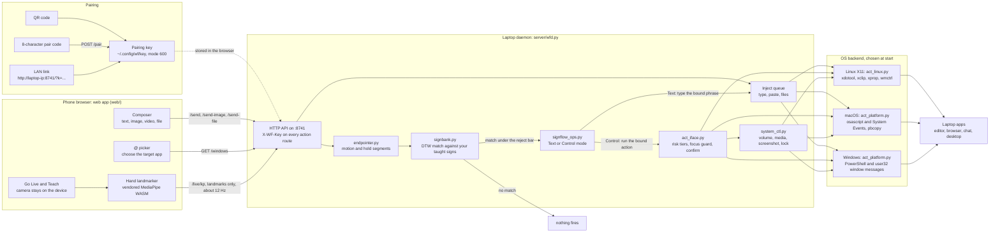
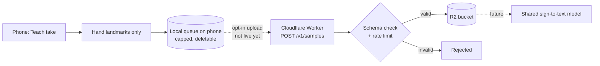

# Sign-Flow

Type and control your laptop without touching it.

Live site: https://sign-flow-eight.vercel.app

Sign-Flow pairs your phone with your laptop over your own network. Type or attach files on the phone and they land in the laptop window you choose. Teach the camera a few signs of your own, and performing a sign types a phrase or runs a laptop action.

- The phone composer sends text, images, videos and files. They are typed or pasted into the focused window, or into an app you pick with `@`.
- Go Live turns the camera into a personal sign controller. Teach a sign in three takes, bind it to a phrase or an action, and perform it to fire the binding.
- Camera video never leaves the browser. Hand tracking runs on the device and only hand landmark points are sent to the laptop.

The laptop side runs on Linux (X11), macOS and Windows. The daemon is standard-library Python with no pip installs and no build step.

## Contents

- [How it works](#how-it-works)
- [Repository layout](#repository-layout)
- [Quick start](#quick-start)
- [Notes per OS](#notes-per-os)
- [Pairing](#pairing)
- [Using it](#using-it)
- [CLI reference](#cli-reference)
- [Tests](#tests)
- [Limitations](#limitations)
- [Licenses](#licenses)
- [Roadmap](#roadmap)
- [Security](#security)

## How it works



Hand landmarks are found in the browser. Matching a landmark sequence against your taught signs happens in the daemon on the laptop, so the bank of signs never leaves your machine.

## Repository layout

```
sign-wrap/
├── bin/
│   ├── wrap                 CLI for Linux and macOS (bash)
│   ├── wrap.js              npm entry: runs bin/wrap on Linux and macOS, server/wrap_cli.py on Windows
│   ├── wrap.cmd             Windows shim for cmd.exe
│   └── wrap.ps1             Windows shim for PowerShell
├── scripts/
│   ├── linux.sh             setup and launch on Linux
│   ├── macos.sh             setup and launch on macOS
│   └── windows.sh           setup and launch on Windows (Git Bash)
├── server/
│   ├── wfd.py               daemon: HTTP, pairing, send, teach, live, actions
│   ├── wrap_cli.py          the same CLI in pure Python, used on Windows
│   ├── wfclip.py            Linux clipboard owner for pasting images and files
│   ├── act_iface.py         action contract, risk tiers, focus guard
│   ├── act_linux.py         Linux X11 backend
│   ├── act_platform.py      macOS and Windows backend
│   ├── system_ctl.py        system actions: volume, media, screenshot, lock, wifi
│   ├── signbank.py          taught-sign bank: normalize, banded DTW, reject
│   ├── endpointer.py        motion segmentation
│   ├── signflow_ops.py      Text and Control mode semantics
│   ├── teach_train.py       checks each Teach take against the others
│   ├── macro.py             chained action steps
│   ├── record_action.py     record an action on the laptop and replay it as a macro
│   ├── packs.py             ready-made Teach packs
│   ├── qrcodegen.py         vendored QR generator
│   ├── qrprint.py           terminal QR printer
│   └── tests/               unit and contract tests
├── web/                     phone web app: composer, Go Live, Teach, settings
│   └── vendor/mediapipe/    vendored hand landmarker (no CDN)
├── app/                     optional Android shell for the web app
├── cloud/contribute/        Cloudflare Worker for opt-in samples (not deployed)
├── landing/                 landing page source (Astro)
├── tests/                   Node tests and browser harness pages
├── tools/fetch-vendor.sh    re-fetch and verify the vendored MediaPipe files
└── package.json             `wrap` command for npm link
```

## Quick start

You need Python 3.7 or newer and Node.js with npm on the laptop, and any modern browser on the phone. Each script checks the tools it needs, runs `npm install`, and starts the daemon. Run it with `setup` to install without starting, or `check` to only check.

### Linux

Log in to an X11 session (for example "Ubuntu on Xorg"). `echo $XDG_SESSION_TYPE` should print `x11`.

```bash
sudo apt install -y nodejs npm python3 curl xdotool x11-utils xclip wmctrl imagemagick python3-xlib
git clone https://github.com/GC-WORK11/sign-wrap.git
cd sign-wrap
scripts/linux.sh
```

The script prints the matching `dnf` and `pacman` lines if a tool is missing. Optional tools: `pulseaudio-utils` or `alsa-utils` (volume), `playerctl` (media keys), `brightnessctl`, `network-manager` (wifi), `libnotify-bin` (confirm prompts), `adb`, `cloudflared`.

### macOS

```bash
brew install node python          # or: xcode-select --install for python3
git clone https://github.com/GC-WORK11/sign-wrap.git
cd sign-wrap
scripts/macos.sh
```

The first time, macOS asks to let your terminal control the computer. Allow it, then run `scripts/macos.sh` again. See [macOS](#macos) below.

### Windows

Install [Git for Windows](https://git-scm.com/download/win) (it includes Git Bash), [Node.js LTS](https://nodejs.org) and [Python 3](https://www.python.org) with "Add python.exe to PATH" ticked. Then open **Git Bash**:

```bash
git clone https://github.com/GC-WORK11/sign-wrap.git
cd sign-wrap
scripts/windows.sh
```

From cmd.exe or PowerShell, skip the script and call the shim directly:

```bat
cd sign-wrap
npm install
bin\wrap.cmd start
```

### After start

`start` runs the daemon in the background (it keeps running after the terminal closes) and prints a LAN link, a QR code and a pair code. If port 8741 is busy, the next free port is used and printed.

Run `npm link` once in the repo to get a `wrap` command on your PATH. Without it, use `bin/wrap` (Linux, macOS), `node bin/wrap.js` (any OS) or the script, for example `scripts/linux.sh status`.

| Task | Linux | macOS | Windows (Git Bash) |
|---|---|---|---|
| Set up and start | `scripts/linux.sh` | `scripts/macos.sh` | `scripts/windows.sh` |
| Check tools | `scripts/linux.sh doctor` | `scripts/macos.sh doctor` | `scripts/windows.sh doctor` |
| Status | `scripts/linux.sh status` | `scripts/macos.sh status` | `scripts/windows.sh status` |
| Show the QR again | `scripts/linux.sh pair` | `scripts/macos.sh pair` | `scripts/windows.sh pair` |
| Follow the log | `scripts/linux.sh logs -f` | `scripts/macos.sh logs -f` | `scripts/windows.sh logs -f` |
| Stop | `scripts/linux.sh stop` | `scripts/macos.sh stop` | `scripts/windows.sh stop` |

## Notes per OS

### Linux

- Typing uses `xdotool`; paste and images go through `xclip`; the `@` picker lists windows with `wmctrl`.
- Wayland is detected and reported by `doctor`. Typing and window control need X11.
- If the phone cannot open the link, allow the port: `sudo ufw allow 8741/tcp`.

### macOS

- **Accessibility.** Typing, key presses and app focus go through System Events. Grant Accessibility to the terminal app that runs `start` (Terminal, iTerm, etc.): System Settings > Privacy & Security > Accessibility. `scripts/macos.sh check` tells you whether it is granted. Restart the daemon after granting it.
- **Screen Recording.** Only the screenshot action needs it. Grant it to the same terminal app under System Settings > Privacy & Security > Screen Recording.
- Text goes on the clipboard with `pbcopy`. Images and files go on the pasteboard through `osascript` (NSPasteboard), and images are converted with `sips`. All three are built in. `blueutil` (Homebrew) is optional, for the Bluetooth action.
- If macOS asks whether Python may accept incoming connections, allow it, or the phone cannot reach the daemon.

### Windows

- Typing works by posting window messages to the focused window, so it needs no extra tools, drivers or admin rights. Clipboard, images and the window list use the built-in PowerShell.
- On first start, Windows Defender Firewall may ask about Python. Allow it on private networks so the phone can connect.
- The daemon keeps running after Git Bash closes. Stop it with `scripts/windows.sh stop`.

### Not yet verified on real hardware

Volume, mute, brightness and lock are implemented for macOS and Windows and pass the unit tests, but have not been checked end to end on a physical Mac or Windows PC. On Linux they are optional and appear only when their tool is installed.

## Pairing

The daemon creates a pairing key on first start and keeps it in `~/.config/wf/key` (mode 600). The phone needs the key once. There are three ways to hand it over:

1. **QR code.** Scan the QR printed by `start` or `pair`. It opens the web app with the key in the link; the key is saved in the browser and removed from the address bar.
2. **Pair code.** Open `http://<laptop-ip>:8741/` on the phone and type the 8-character code shown by `pair`. The code changes on every start; the key does not.
3. **LAN link.** Open the printed `http://<laptop-ip>:8741/?k=...` link in any browser on the same network.

The phone and laptop must be on the same network. For other setups:

- **USB:** `wrap bridge` runs `adb reverse`, then open `http://localhost:8741` on the phone.
- **Anywhere:** `wrap tunnel` gives an https link through `cloudflared`. It works for the composer. Live and Teach are refused through a tunnel on purpose.

**Camera and secure context.** Phone browsers only allow the camera on https or `localhost`. A plain `http://<lan-ip>` page can send text and files but cannot open the camera. For Go Live and Teach, use the laptop browser at `http://localhost:8741`, or the phone over USB with `wrap bridge`.

## Using it

**Composer.** Type in the box and press send. The text is typed at the laptop cursor.

**@ app picking.** Type `@` in the composer to list the open apps and windows on the laptop. Pick one and the next send goes there: the daemon focuses that window first, then types or pastes.

**Text, images and videos.**

| You send | What happens on the laptop |
|---|---|
| Text | Typed into the focused or picked window |
| Image | Put on the clipboard as a picture and pasted, so it lands in chats, docs and editors |
| Video or other file | Saved to `~/wf-uploads/` and pasted as a file where the app accepts files |

**Go Live.** Tap the live button to start the camera. Two modes:

- **Text:** a performed sign types its bound phrase, for example "Hello".
- **Control:** the same sign runs its bound action: open an app, press keys, switch windows, change volume, take a screenshot.

**Teach.** Open Teach and tap what the sign should do in the one-tap grid: a laptop action, an app, or a phrase to type. The name fills in from the tile; change it if you like. Perform the sign three times and finish. You can also skip the grid and pick any action with `@` after recording. The takes are checked against each other before the sign goes live. Ready-made signs (Hello, Introduce yourself) are tiles in the same grid. An open palm starts listening and Namaste (palms together) stops it; both are built in and cannot be retaught.

**Safety.** Actions fired by a sign check the focused window when they fire and refuse when it cannot be verified. A composer send goes to the window you picked with `@`; if that window has closed, the laptop refuses the send instead of typing somewhere else. Destructive actions, such as closing a window, wait for a confirmation. `WF_TYPE_ALLOW=<regex>` limits sign-fired actions to windows whose class or title matches.

## CLI reference

The same commands exist on every OS (`bin/wrap` on Linux and macOS, `server/wrap_cli.py` on Windows, both behind `wrap` after `npm link`).

| Command | Effect |
|---|---|
| `wrap start` | Start the daemon and print the LAN link, QR and pair code |
| `wrap pair` | Show the QR, link and code again |
| `wrap restart` | Stop, then start (new pair code, same key) |
| `wrap status` | Up or down, pid, memory, LAN link, USB and tunnel state |
| `wrap logs` / `wrap logs -f` | Last lines of the daemon log, or follow it |
| `wrap send "text"` | Type text into the focused laptop window |
| `wrap doctor` | Check required and optional tools and the session |
| `wrap bridge` | USB: `adb reverse` so the phone can use `localhost:8741` |
| `wrap tunnel` | https link through `cloudflared` |
| `wrap install` / `wrap open` | Build and install, or launch, the optional Android app |
| `wrap stop` | Stop the daemon and any tunnel |

Set `WF_PORT` to use another port, for example `WF_PORT=8800 wrap start`. Taught signs and bindings live in `~/.config/wf/`. Logs and pid files are written to the repo folder and are gitignored.

## Tests

```bash
cd server && python3 -m unittest discover -s tests
node --test tests/contribute.test.mjs tests/kp-pack.test.mjs
```

The Python suite covers the macOS and Windows backends with mocked system calls, so it runs on any OS.

## Limitations

See [`LIMITATIONS.md`](LIMITATIONS.md). In short:

- Signs are personal and taught by each user. Sign-Flow is not a fixed sign-language recognizer.
- Linux needs X11. Wayland is detected and reported.
- Go Live needs a secure context on the phone (see [Pairing](#pairing)).
- Typing and key actions check the focused window first and refuse when it cannot be verified.

## Licenses

All components are commercial-compatible:

| Component | License | File |
|---|---|---|
| Sign-Flow (this repo) | MIT | `LICENSE` |
| QR Code generator (vendored `server/qrcodegen.py`) | MIT — © Project Nayuki | header of the file |
| MediaPipe Tasks Vision + hand-landmarker model (vendored `web/vendor/mediapipe/`) | Apache-2.0 — © Google | `web/vendor/mediapipe/NOTICE.md` + `MANIFEST` |

`cloud/contribute/` uses only dev tooling (TypeScript Apache-2.0, Wrangler MIT OR Apache-2.0, workers-types MIT OR Apache-2.0); nothing from it ships in the app.

No GPL/AGPL, non-commercial, or research-only licensed code ships in this tree.

## Roadmap

Today every sign is personal: it is taught on your phone and matched on your laptop. The next step is a shared sign-to-text model that works before you teach anything.

That model will be trained only on samples people choose to share. Sharing will be an opt-in setting, **Share training samples (beta)**, off by default. The setting is not in the app in this release, so nothing is collected. When it ships and is on, each Teach take will be kept on the phone as hand landmarks only. See [`PRIVACY.md`](PRIVACY.md) for exactly what is and is not collected.



| Stage | State |
|---|---|
| Local landmark queue (`web/js/contribute.js`) | written and tested, no setting in the app yet |
| Intake Worker (`cloud/contribute/`) | written and tested, not deployed |
| Upload from the app | off: no endpoint is configured |
| Shared model | planned |

## Security

See [`SECURITY.md`](SECURITY.md) for the threat model and how to report a vulnerability. Privacy details are in [`PRIVACY.md`](PRIVACY.md).
